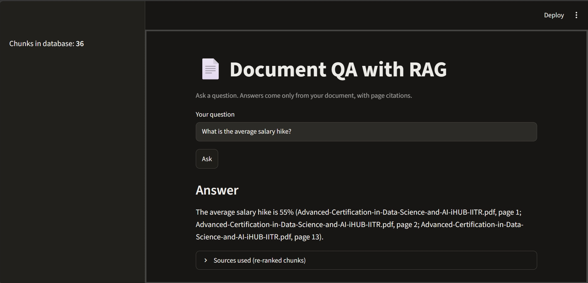

# Document QA with RAG

A question-answering system that answers questions **only** from a PDF, cites the source page for every answer, and refuses when the answer isn't in the document. I built it from scratch (no LangChain) and measured each design choice with an evaluation harness.



## Results

Evaluated on **30 hand-written questions** about one 15-page PDF (a course brochure). A retrieval counts as correct only if a retrieved chunk contains the answer text **and** comes from a page that states it.

| Setup | Hit@1 | Hit@3 | Hit@5 | MRR |
|---|---|---|---|---|
| Baseline (500-char chunks, vector search) | 43.3% | 70.0% | 80.0% | 0.579 |
| 800-char chunks, vector search | 50.0% | 66.7% | 90.0% | 0.634 |
| **800-char chunks + cross-encoder re-ranker (final)** | **76.7%** | **93.3%** | **96.7%** | **0.853** |

Retrieval Hit@5 improved from **80.0% to 96.7%**, and Hit@1 from **43.3% to 76.7%**. The re-ranker contributed most of the gain.

### Experiment 1: chunking strategies (vector search only)

| Config | Chunks | Hit@1 | Hit@3 | Hit@5 | MRR |
|---|---|---|---|---|---|
| fixed 500 / overlap 100 | 51 | 43.3% | 70.0% | 80.0% | 0.579 |
| fixed 300 / overlap 50 | 82 | 50.0% | 73.3% | 83.3% | 0.623 |
| fixed 800 / overlap 150 | 36 | 50.0% | 66.7% | 90.0% | 0.634 |
| line-packed 500 | 47 | 53.3% | 63.3% | 86.7% | 0.623 |
| line-packed 300 | 82 | 40.0% | 83.3% | 86.7% | 0.596 |

Takeaway: chunk size changed results by only 1 to 3 questions (3.3 points each), so most gaps are within noise. Line-packed chunking (whole lines, never cut mid-line) did **not** clearly beat plain fixed-size chunking.

### Experiment 2: re-ranker

Vector search fetches the top 20 candidates, then `cross-encoder/ms-marco-MiniLM-L-6-v2` reorders them and the top 5 are kept.

| Chunking | Setup | Hit@1 | Hit@3 | Hit@5 | MRR |
|---|---|---|---|---|---|
| fixed 500 / 100 | vector only | 43.3% | 70.0% | 80.0% | 0.579 |
| fixed 500 / 100 | + re-ranker | 73.3% | 90.0% | 93.3% | 0.825 |
| fixed 800 / 150 | vector only | 50.0% | 66.7% | 90.0% | 0.634 |
| fixed 800 / 150 | + re-ranker | 76.7% | 93.3% | 96.7% | 0.853 |
| line-packed 500 | vector only | 53.3% | 63.3% | 86.7% | 0.623 |
| line-packed 500 | + re-ranker | 76.7% | 86.7% | 93.3% | 0.833 |

The re-ranker improved every chunking config, and Hit@1 rose by 23 to 30 points.

## How it works

1. **Ingest:** `pypdf` extracts text page by page, keeping file name and page number.
2. **Chunk:** fixed-size character chunks (800 chars, 150 overlap), each tagged with source and page.
3. **Embed and store:** `all-MiniLM-L6-v2` (sentence-transformers) vectors in ChromaDB (cosine similarity).
4. **Retrieve:** top 20 by vector search, re-ranked by a cross-encoder, top 5 kept.
5. **Generate:** Google Gemini answers using only the retrieved excerpts, with page citations. If the answer isn't there, it replies "I don't know based on the provided document."
6. **Citation check:** a script flags any cited page that wasn't among the retrieved chunks.

Gemini calls retry with exponential backoff and fall back to a second model on 503/504 errors.

## Project structure

```
src/
  load_documents.py     PDF to text with page numbers
  chunking.py           fixed-size chunking
  embeddings.py         embedding model
  vector_store.py       builds the ChromaDB index
  retrieval.py          vector search + re-ranking
  generate.py           prompt, Gemini call, citation check
  app.py                Streamlit interface
  evaluate.py           evaluation harness (Hit@k, MRR)
  experiment.py         chunking comparison
  experiment_rerank.py  re-ranker comparison
eval/
  questions.json        30-question test set
  results_*.json        saved results
```

## Run it

```bash
python -m venv venv
venv\Scripts\activate              # Windows (Mac/Linux: source venv/bin/activate)
pip install -r requirements.txt
```

1. Put a text-based PDF in `data/`.
2. Create `.env` with `GEMINI_API_KEY=your_key` (free key from Google AI Studio).
3. Build the index and start the app:

```bash
python src/vector_store.py
streamlit run src/app.py
```

Reproduce the evaluation:

```bash
python src/evaluate.py final --rerank   # final pipeline
python src/experiment.py                # chunking comparison
python src/experiment_rerank.py         # re-ranker comparison
```

The test questions in `eval/questions.json` were written for the brochure I used, which isn't included in this repo. To evaluate your own PDF, write your own questions in the same format (`question`, `answer_contains`, `pages`).

## Limitations

- **Small test set:** 30 questions, one document. One question is worth 3.3 points, so differences of 1 to 2 questions are noise.
- **Not a held-out test:** I chose the final config after seeing results on the same 30 questions, so the numbers are optimistic for new documents.
- **Retrieval only:** the harness measures whether the right chunk is found, not how good Gemini's final answers are. I checked answers and citations manually on a few questions.
- **Text-only PDFs:** scanned documents need OCR, which isn't included.

## Tech stack

Python, pypdf, sentence-transformers, ChromaDB, Google Gemini API, Streamlit.